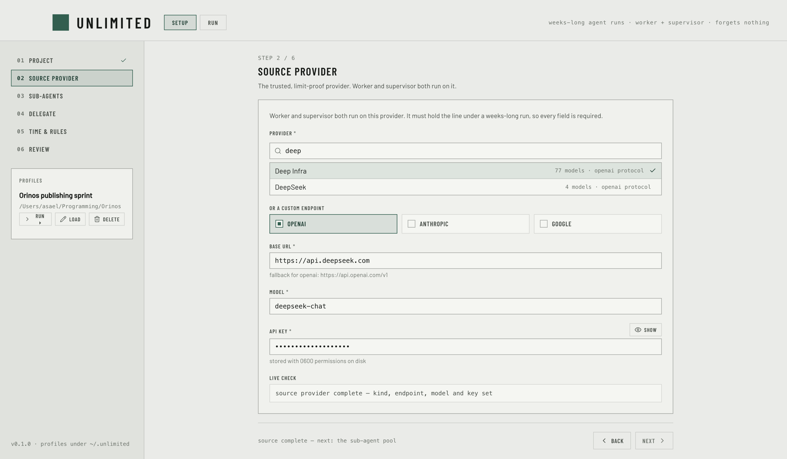
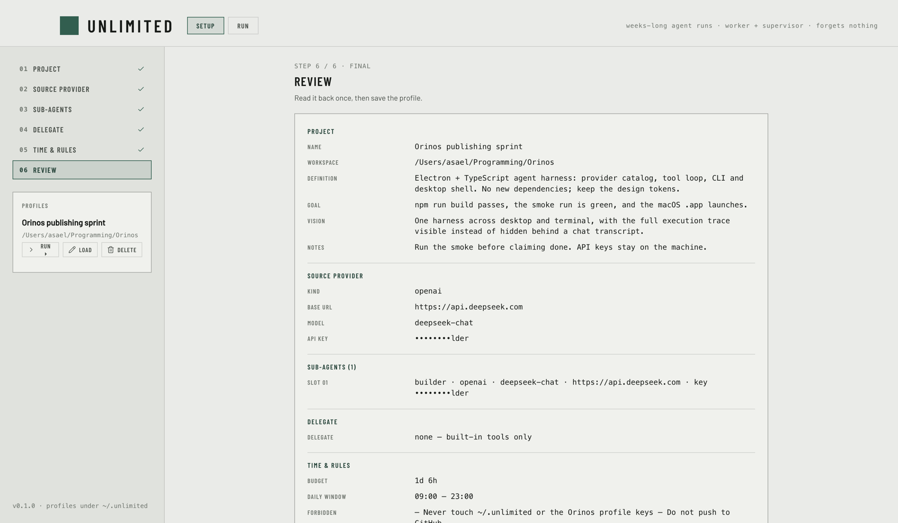

# Unlimited

**A weeks-long autonomous agent orchestrator for macOS.** You write the project brief, pick a
provider you trust to hold the line, and set the rules. Unlimited keeps a crew of agents working
while you are away — with a supervisor copy that watches every move and can kill any agent that
steps out of line.

[](LICENSE)
[](#requirements)
[](#status)



## Why it exists

A long autonomous run usually dies in one of three ways: the planner's context drowns in its own
tool output, the provider hits a limit and the whole run stalls, or nobody is watching what the
agents actually do. Unlimited is built around those three failure modes:

- **The planner never builds.** The worker has no write, edit, or terminal tools. It plans,
  dispatches work orders, reads results, and verifies. Its context stays a plan, not a pile of code.
- **The source provider is the run's spine.** Worker and supervisor both run on the one provider
  you mark as limit-proof, so a cheap sub-agent provider running out of credit cannot stop the run.
- **Someone is always watching.** A supervisor copy reads the same event stream, enforces the
  forbidden list and workspace boundary deterministically, then judges intent with the model.
  It warns once and kills on repeat.

## The crew

- **Worker main agent** — plans, dispatches, and verifies. Inspection-only tools; every change
  goes through a sub-agent.
- **Sub-agents (1–25)** — each with its own provider, model, and key. A slot is a **persistent
  session**: the first dispatch opens it with a stated deliverable, every later dispatch is a
  follow-up in the same context. There is no "new agent per tool call".
- **Coordinators (max 2)** — spawned by the worker when the work outgrows it. They decompose,
  dispatch, and review; they never write files or run commands.
- **Supervisor** — a copy of the worker on the same trusted provider. Deterministic checks first,
  then LLM verdicts: warn → repeat → kill.
- **Delegate (optional)** — instead of built-in tools, the crew can drive an external CLI:
  OpenCode, Claude Code, Codex, or Kimi Code. Health-checked before the run starts.

## 233 providers, three protocols

The pickers draw from the **models.dev catalog** — 233 providers / 8,882 models at the last build —
each mapped to one of three wire protocols: OpenAI-compatible, Anthropic, or Google. Pick a
provider and its endpoint and protocol are filled in; the model field suggests that provider's
models. A custom endpoint is always available as an escape hatch.

The catalog is refreshed at build time (`npm run catalog`) and a fetched copy ships in the repo,
so the app works offline.

## Configure once

Six steps: project, source provider, sub-agent pool, delegate, time and rules, review.



## Run

The run console is mission control: budget clock, supervisor verdicts, one card per agent, and a
filtered event feed (tools, results, text, compaction pressure, supervision). **PANIC** stops every
agent and delegate child immediately. Runs are journaled under `~/.unlimited/runs`; a crash or a
closed window leaves a resumable run behind.

## Compaction that forgets nothing

Context is managed in three layers: a **pinned** block (goal, rules, ledger, warnings) that is
re-injected every turn, **hot** recent episodes verbatim with tool outputs reduced to their kernel,
and a **cold** store on disk behind a searchable `recall` tool. Nothing is silently truncated;
every eviction is reported as an event.

## Requirements

- macOS (Apple silicon or Intel). Windows packaging is not verified yet.
- Node.js 20 or newer.
- An API key for your trusted source provider, plus one key per sub-agent slot.

## Develop

```bash
npm install
npm run typecheck
npm test           # 105 tests
npm start          # build + open the desktop app
npm run smoke      # headless boot, screenshot, exit
```

Profiles and run journals live under `~/.unlimited` (override with `UNLIMITED_HOME`). Profile files
contain API keys and are written `0600`.

## How it is built

- Electron main process + React renderer, bundled with esbuild and Vite; no remote UI at runtime.
- Provider clients for OpenAI-compatible, Anthropic, and Google streaming APIs.
- A run journal (JSONL), a budget clock with an optional daily work window, and crash resume.
- Tests run with `node --test`; the smoke harness boots the real app and captures a screenshot.

## Status

| Phase | What landed |
| --- | --- |
| 0 | Scaffold, locked contracts, profile storage, smoke harness |
| 2 | Provider clients, budget, journal, agent runner, supervisor, orchestrator |
| 3 | Compaction engine: meter, ledger, recall, elision |
| 5 | Crash resume + turn watchdog |
| 6 / 6.5 | Run console, interrupted-run affordance |
| 7 | models.dev provider catalog, searchable picker |
| — | Worker as orchestrator, persistent sub-agent sessions |

Next: spend telemetry, usage-anchored token calibration, parallel dispatch, Windows packaging.

## Safety

- API keys stay on the machine, in `~/.unlimited`, written `0600`; nothing is committed.
- The forbidden list is pinned into every agent's context and enforced by the supervisor.
- The worker can only touch the workspace you chose; escaping it is a supervised violation.
- One button stops every running agent.

## License

MIT — see [LICENSE](LICENSE).
